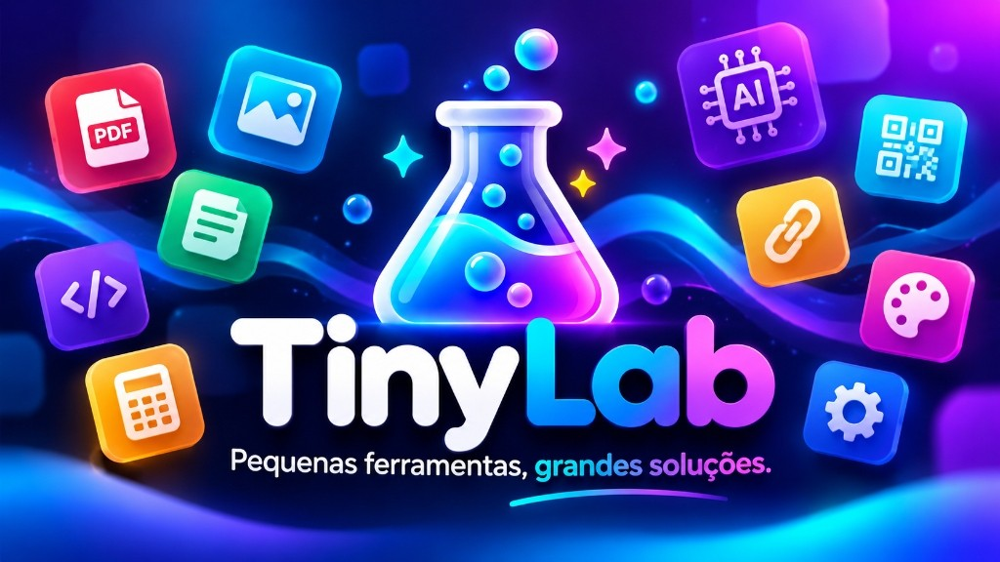

# 🧪 TinyLab v2.1 — Suíte com 159 Ferramentas Web Livres, Rápidas & Privadas

<p align="center">
  
</p>

<p align="center">
  <strong>PT-BR</strong> · <a href="#-english">English below</a> ·
  <a href="https://4u.ia.br/app/tinylab/">🌐 Acessar App Online</a> ·
  <a href="https://4u.ia.br/loja/">🛍️ Loja 4u Hub</a> ·
  <a href="https://4u-labs.github.io/">📝 Blog Dev</a>
</p>

---

**TinyLab** é o laboratório de utilitários digitais tudo-em-um da **[4u-Labs](https://4u.ia.br/)**, projetado como alternativa moderna, aberta, rápida e **privada por padrão** a suítes cheias de anúncios, filas artificiais e limites diários. Reúne **159 ferramentas em 7 categorias**, bilíngue (**PT-BR / EN**), instalável como **PWA** com **Share Target** e **modo offline**.

## ✨ Destaques da Versão 2.1

- **159 Ferramentas em 7 Categorias:** PDF & E-books (35), Imagens & Formatos Pro (31), Vídeo, Áudio & YouTube (35), Dados & Planilhas (15), Texto (8), Dev & QR/Barras (15) e IA Local (20).
- **Privacidade Local-First:** Operações no navegador rodam via **WebAssembly**, **WebGPU**, **Canvas** e **Web Workers** diretamente na memória do seu dispositivo — sem enviar seus arquivos para nuvens de terceiros.
- **Colar Global (`Ctrl+V`) & Web Share Target:** Cole capturas de tela, fotos ou PDFs em qualquer lugar da página (ou compartilhe direto da galeria do celular para o PWA instalado) com barra rápida para alternar entre ferramentas em 1 clique.
- **Encadeamento Inteligente:** Envie o arquivo gerado diretamente para a próxima ferramenta (*ex.: Remover Fundo → Comprimir Imagem*, *OCR PDF → Assinar PDF*) sem precisar baixar e reenviar.
- **SEO Nativo & URLs Limpas:** 148 páginas estáticas individuais (`/app/tinylab/<ferramenta>/`) com metadados Open Graph, JSON-LD (`WebApplication` + `FAQPage`) e `sitemap.xml` gerados automaticamente no build.

## 🧰 Catálogo por Categoria

| Categoria | Qtd | Principais Ferramentas |
| :--- | :---: | :--- |
| 📄 **PDF & E-books** | 35 | Juntar, Dividir, Comprimir inteligente (recomprime imagens internas mantendo texto vetorial), PDF pesquisável (OCR), PDF ↔ Word/Excel/PowerPoint (`.pptx`), **EPUB ↔ PDF**, **Editar texto no PDF**, **PDF em Tons de Cinza**, **Comparar 2 PDFs**, Assinar multipáginas vetorial, Anotar, Tarjar dados confidenciais (Redaction permanente), Achatar (Flatten), N-up (2/4/6/9 por folha), Markdown → PDF, Metadados e Criptografia AES-256 |
| 🎨 **Imagens** | 31 | Remover fundo (Cor + IA ORMBG/MODNet + pincel Apagar/Restaurar), Desfocar fundo (Bokeh IA), Remover Objetos/Marcas-d'água (Inpainting), **Abrir/Converter PSD / TIFF / BMP / ICO**, **Extrator de Paleta de Cores** (HEX/RGB/CSS/Tailwind + conta-gotas interativo), **Colorir Foto P&B**, **Criador de Stickers 512×512 WebP** (WhatsApp/Telegram), Vetorizar PNG/JPG → SVG em cores, Carrossel/Grade Instagram, Foto de Perfil (PFPMaker), Mockup de Print macOS & Memes, AVIF/WebP/PNG/JPG/HEIC |
| 🎬 **Vídeo & Áudio** | 26 | Cortar vídeo/áudio com timeline visual de duas alças, Queimar legendas `.srt` no vídeo, **Texto para Voz (TTS → WAV)**, **Adicionar Música em Vídeo**, **Inverter Vídeo (Rebobinar)**, **Limpar Ruído de Voz (Denoise / Podcast / Karaokê)**, Juntar vídeos (Concat), Formato Vertical 9:16 (Reels/Shorts/TikTok), Velocidade 0.5×–3×, Extrair áudio/frames, GIF, Gravador de Tela e Gravador de Voz com ondas ao vivo + atalhos para **ClipCut** e **BAIXOU!!** |
| 📊 **Dados & Arquivos** | 15 | CSV ↔ Excel (`.xlsx`) ↔ JSON ↔ XML ↔ YAML, Criar/Extrair ZIP, Hashes de arquivo (`SHA-256`/`SHA-512`), Comparar pastas/arquivos e Limpeza de planilhas |
| ✍️ **Texto** | 8 | Contador de palavras/tempo de leitura, Limpar formatação, Maiúsculas/Minúsculas, Ordenar/Deduplicar linhas, Slug URL e **Diff Visual** colorido lado a lado ou unificado |
| ⚙️ **Dev & Utilitários** | 15 | **QR Code Studio** (`PNG` + `SVG` vetorial + Logo central, PIX Copia e Cola, Wi-Fi, vCard, WhatsApp), **Leitor de QR/Barras** por imagem ou câmera ao vivo, Gerador de Código de Barras (`EAN-13`, `EAN-8`, `UPC-A`, `Code 128`), Decodificador JWT (com verificação HMAC), Testador de Regex em tempo real, UUID, Base64 e Gerador de Senhas |
| 🤖 **IA Local** | 20 | Recorte IA (`ORMBG` / `MODNet`), Super-Resolução 2× (`Swin2SR`), Transcrição de Áudio/Vídeo (`Whisper`), OCR PT/EN (`Tesseract`), Resumo, Tradução, Revisão e suíte **AI Write** local (E-mail, Artigo/Post, Descrição de Produto, Roteiro YouTube/Reels, FAQ/Flashcards, **Currículo & Carta**, **Nomes de Marca & Slogan**, **Termos & Privacidade LGPD/GDPR**, **Resumidor de Reunião/Aula** e **Explicador de Código & SQL** com `Qwen2.5` via WebGPU/WASM) |

## 🚀 Como Executar e Compilar Localmente

Requisitos para build/manutenção: **Node.js 20+** (recomendado 22+) e Python 3 para o servidor local de prévia. A versão compilada é 100% estática (com endpoint opcional efêmero para LibreOffice).

```bash
# 1. Instalar dependências (sem baixar binários CUDA desnecessários)
ONNXRUNTIME_NODE_INSTALL_CUDA=skip npm ci

# 2. Gerar bundles, vendor/, sw.js, 148 páginas SEO e sitemap.xml
npm run build

# 3. Executar suíte de testes automatizados (Node + servidor local)
npm test
python3 -m unittest tests/server_test.py

# 4. Iniciar servidor local em http://127.0.0.1:4173
npm run dev
```

## 🔒 Arquitetura de Privacidade e Limites Transparentes

- **Zero Upload nas Operações do Navegador:** PDFs, imagens, vídeos, planilhas, QR Codes e textos são processados localmente na memória do navegador.
- **Modelos de IA sob Demanda:** Na primeira execução de uma ferramenta de IA generativa, visão ou áudio, o modelo correspondente (`onnx-community/ormbg-ONNX`, `Xenova/modnet`, `Xenova/swin2SR-classical-sr-x2-64`, `Xenova/whisper-tiny` ou `onnx-community/Qwen2.5-0.5B/1.5B-Instruct`) é baixado diretamente para o cache do navegador e executado localmente via **WebGPU** (com fallback automático para **WASM**).
- **Conversão Office Efêmera (Opcional):** A conversão de fidelidade total `Word/Excel/PowerPoint → PDF` via LibreOffice processa o arquivo em diretório temporário isolado e o remove imediatamente após devolver o PDF, sem retenção ou banco de arquivos.
- **Modo Offline:** O botão **Preparar offline** armazena os pacotes WebAssembly e scripts principais no Cache Storage do navegador (gerenciado exclusivamente sob o prefixo `tinylab-v2-`).
- **Avisos de Terceiros:** Consulte [`THIRD_PARTY_NOTICES.md`](THIRD_PARTY_NOTICES.md) para detalhes das bibliotecas open-source e licenças distribuídas em `vendor/licenses/`.

---

## 🌍 English

**TinyLab v2.1** is an ad-free, local-first web utility suite by **[4u-Labs](https://4u.ia.br/)** featuring **159 tools across 7 categories** (PDF & E-books, Image & Pro Formats, Video, Audio & YouTube, Data & Spreadsheets, Text, Dev/QR/Barcodes, and Local AI), full **PT-BR / EN** internationalization, **PWA Web Share Target**, global clipboard paste (`Ctrl+V`), 1-click tool chaining, and offline support.

### Key Highlights
- **35 PDF & E-book Tools:** Merge, Split, Smart Compress (recompresses embedded images while keeping vector text), Searchable PDF OCR, PDF ↔ Word/Excel/PowerPoint (`.pptx`), **EPUB ↔ PDF**, **Edit PDF Text**, **Grayscale PDF**, **Compare 2 PDFs**, Multi-page Vector Sign & Annotate, Permanent Redaction, Flatten, N-up imposition, Markdown → PDF, Metadata editor/wiper, and AES-256 encryption.
- **31 Image Tools:** Background removal (Color flood-fill + local `ORMBG`/`MODNet` AI + interactive Erase/Restore brush), Portrait Bokeh Blur, Object/Watermark Inpainting, **PSD / TIFF / BMP / ICO Converter**, **Color Palette Extractor & Pixel Picker**, **Colorize B&W Photo**, **512×512 WebP Sticker Pack Maker**, Color PNG/JPG → SVG Vectorizer, Instagram Carousel Splitter, PFPMaker, macOS Screenshot Mockup & Meme Generator, and AVIF/WebP/PNG/JPG/HEIC conversion.
- **35 Video, Audio & YouTube Tools:** Dual-handle visual trim timeline, Hardcoded `.srt` subtitle burner, **YouTube Creator Suite (Thumbnails, Tags, Description, Shorts Script, Embed Generator, Earnings Calc)**, **Text-to-Speech (TTS → WAV)**, **Add Audio/Music to Video**, **Reverse Video**, **Audio Denoise & Voice Enhancer**, Video Concat, 9:16 Vertical Reels/Shorts formatter, 0.5×–3× Speed control, Screen & Live Waveform Voice Recorders, plus direct integration with **ClipCut** and **BAIXOU!!**.
- **Data, Text, Dev & Local AI (58 Tools):** CSV ↔ Excel ↔ JSON ↔ XML ↔ YAML, ZIP archiver, Side-by-side Diff Viewer, **QR Code Studio** (`PNG` + `SVG` + Center Logo, PIX, Wi-Fi, vCard), Live Camera QR/Barcode Scanner, `EAN-13`/`Code 128` SVG Generator, JWT Decoder (HMAC verification), Live Regex Tester, Whisper transcription, Swin2SR 2× upscaling, and 10 local `Qwen2.5` AI Write tools with automatic WebGPU acceleration.

### Build & Test
```bash
ONNXRUNTIME_NODE_INSTALL_CUDA=skip npm ci
npm run build
npm test
python3 -m unittest tests/server_test.py
```

---

<p align="center">
  Feito com 💜 por <a href="https://4u.ia.br/">4u-Labs</a> · <a href="https://4u.ia.br/app/tinylab/">4u.ia.br/app/tinylab</a>
</p>
